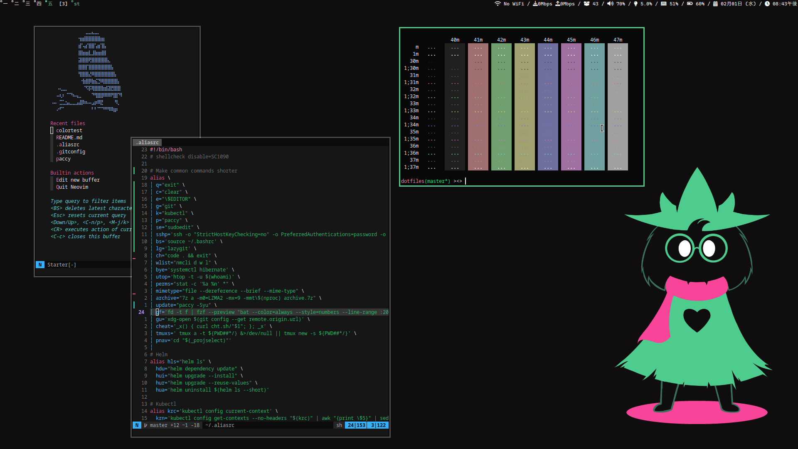
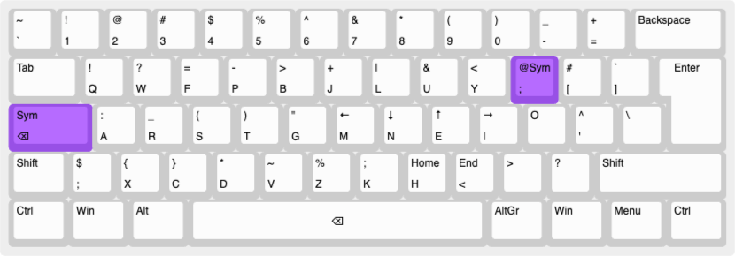

# dotfiles

this is my personal dotfiles repo. mostly a place to keep the config i use
across machines, but there are a few aliases and scripts in here that might be
useful to you as well.

## machine profiles

`base` is the shared setup i use on both personal and work machines. personal
settings live in `profiles/personal/` and are only installed when i opt in:

```sh
mise run install base      # shared shell, editor, agent config, and tools
mise run install personal  # shared setup + personal git identity and extra tools
```

the choice is saved in `~/.config/dotfiles/profile`, outside the repo. running
`mise run install` again reuses it; a new machine defaults to `base`. switching
to `base` removes the personal overlay's symlinks. it doesn't uninstall packages
or delete local files. start a new login shell after switching (`exec bash -l`).
`echo "$DOTFILES_PROFILE"` shows the profile loaded by the shell.

login shells on personal machines also select `MISE_ENV=personal`, so both
the global tools and this repo's bootstrap packages use the same profile.
an explicitly set mise environment takes precedence. preview package changes
with `mise bootstrap --dry-run` before applying them with `mise bootstrap`.
linux is a separate platform layer: use `mise -E linux bootstrap`, or
`mise -E personal,linux bootstrap` on a personal linux machine.

keep shared config in `home/`, `.config/`, and `.local/`. add personal files in
the matching directories under `profiles/personal/`; the installer handles
each as a separate Stow package. personal bootstrap packages stay in
`mise.personal.toml`. work identities, credentials, and machine-specific
settings belong in local files, outside the tracked packages.

base doesn't set a git name or email, and git requires an explicit identity.
put your work identity in `~/.gitconfig.local`, which is included last:

```gitconfig
[user]
  name = Your Name
  email = you@company.example
```

if you use a personal machine for work too, scope that identity to your work
checkout directory instead. put this in `~/.gitconfig.local` and keep the
identity in `~/.gitconfig.work`:

```gitconfig
[includeIf "gitdir:~/work/"]
  path = ~/.gitconfig.work
```

shared settings can still be overridden with repo-local `git config` values.
shell-only local settings can go in the existing `~/.privrc` hook.

## skills

i like to keep things fairly minimal. if you are interested in my skills,
check them out in the [skills directory](home/.agents/skills/) or run
`npx skills add ALX99/dotfiles --list`.

## software i like

- distro: [arch](https://archlinux.org/)
- compositor: [hyprland](https://hypr.land/)
- agent harness: [pi](https://pi.dev/)
- browser: [brave](https://brave.com/)
- editor: [neovim](https://neovim.io/)
- terminal emulator: [ghostty](https://ghostty.org/)
- terminal multiplexer: [tmux](https://github.com/tmux/tmux)
- shell: [bash](https://www.gnu.org/software/bash/)

## pictures



## keyboard

[colemak dh](https://colemakmods.github.io/mod-dh/) is nice



## map

for reference, here's roughly what's in here:

- [.profile](https://github.com/ALX99/dotfiles/blob/master/home/.profile)
      - Generic profile
- [.bashrc](https://github.com/ALX99/dotfiles/blob/master/home/.bashrc)
      - Bashrc
- [.bashrc.d/](https://github.com/ALX99/dotfiles/tree/master/home/.bashrc.d)
      - Bashrc includes
- [.aliasrc](https://github.com/ALX99/dotfiles/blob/master/home/.aliasrc)
      - Aliases
- [bin/](https://github.com/ALX99/dotfiles/tree/master/.local/bin)
      - Shell scripts
- [.config/](https://github.com/ALX99/dotfiles/tree/master/.config)
      - Program configs
- [.config/nvim](https://github.com/ALX99/dotfiles/tree/master/.config/nvim)
      - Neovim config
- [skills/](https://github.com/ALX99/dotfiles/tree/master/home/.agents/skills)
      - Agent skills
- [misc/](https://github.com/ALX99/dotfiles/tree/master/misc)
      - System-level configs (systemd, keymaps, pacman-hooks)
