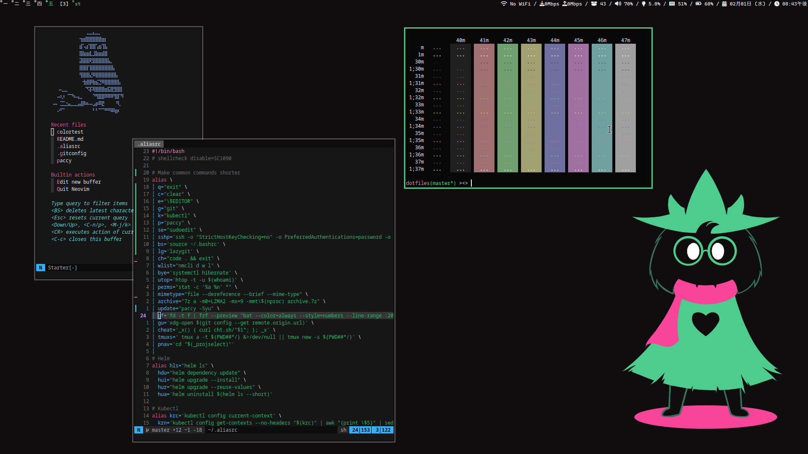
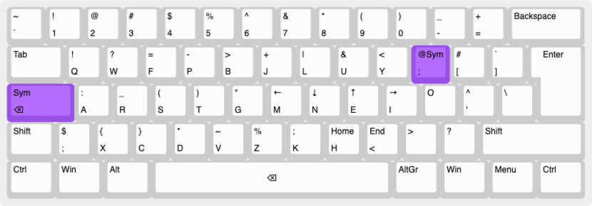

# dotfiles

this is my personal dotfiles repo. mostly a place to keep the config i use
across machines, but there are a few aliases and scripts in here that might be
useful to you as well.

## Pi settings

`home/.pi/agent/settings.json` installs to `~/.pi/agent/settings.json` through
`mise run install` (the Stow `home` package). Before the first install, back up
and move aside any existing regular settings file; Stow will not overwrite it.
Pi settings edits also update this tracked file through the symlink.
Extensions and other Pi resources are managed separately in the pi-lot repository.

## skills

i like to keep things fairly minimal. if you are interested in my skills,
check them out in the [skills directory](home/.agents/skills/) or run
`npx skills add ALX99/dotfiles --list`.

## software i like

- distro: [arch](https://archlinux.org/)
- compositor: [hyprland](https://hypr.land/)
- agent harness: [pi](https://pi.dev/)
- browser: [brave](https://brave.com/)
- editor: [neovim](https://neovim.io/)
- terminal emulator: [ghostty](https://ghostty.org/)
- shell: [bash](https://www.gnu.org/software/bash/)

## pictures

## keyboard

[colemak dh](https://colemakmods.github.io/mod-dh/) is nice

## map

for reference, here's roughly what's in here:

- [.bash_profile](https://github.com/ALX99/dotfiles/blob/master/home/.bash_profile)
      - Generic profile
- [.bashrc](https://github.com/ALX99/dotfiles/blob/master/home/.bashrc)
      - Bashrc
- [.bashrc.d/](https://github.com/ALX99/dotfiles/tree/master/home/.bashrc.d)
      - Bashrc includes
- [.aliasrc](https://github.com/ALX99/dotfiles/blob/master/home/.aliasrc)
      - Aliases
- [bin/](https://github.com/ALX99/dotfiles/tree/master/home/.local/bin)
      - Shell scripts
- [.config/](https://github.com/ALX99/dotfiles/tree/master/home/.config)
      - Program configs
- [.config/nvim](https://github.com/ALX99/dotfiles/tree/master/home/.config/nvim)
      - Neovim config
- [skills/](https://github.com/ALX99/dotfiles/tree/master/home/.agents/skills)
      - Agent skills
- [misc/](https://github.com/ALX99/dotfiles/tree/master/misc)
      - Keyboard layouts and generated theme assets
